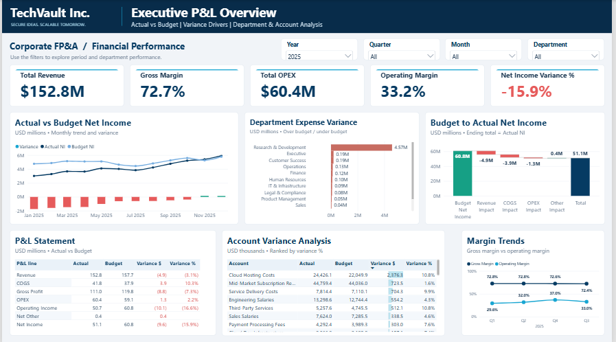
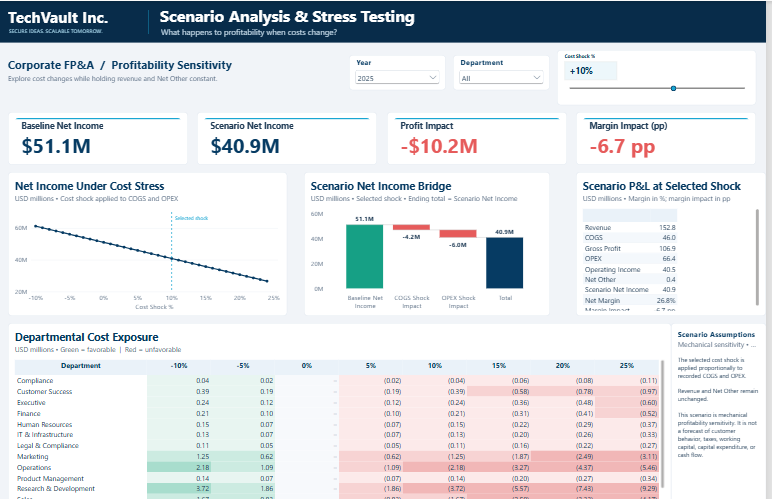

# Phase 3 — Power BI: Executive FP&A Reporting & What-If Decision Support

[Back to project overview](../README.md) · [Excel phase](../excel/README.md) · [SQL phase](../sql/README.md)

## Business objective

Turn validated financial actuals and budget into a reporting interface that answers **what happened, where the variance came from, how profitability changed, and what earnings look like under a transparent cost assumption**. The two screenshots below represent the user's visible report output; the underlying `.pbix` was not uploaded for independent formula inspection.





## Model design

**Source:** PostgreSQL database `techvault_fpa`, **Import** mode, from the **`core` schema**. Core facts and dimensions are distinct. SQL marts are QA references, not a second additive layer inside the main semantic model.

```text
                        Dim_Date
                        /      \
                       /        \
               Fact_Actuals    Fact_Budget
                    ^   ^        ^   ^
                    |   |        |   |
         Dim_Department +--------+   |
                    Dim_Account -----+

             Dim_Location   → Fact_Actuals
             Dim_Cost_Center→ Fact_Actuals
```

Each dimension uses a **one-to-many, single-direction** relationship to applicable facts. **No direct Actual↔Budget fact relationship.** The shared Date, Department and Account tables filter actual and budget independently, which supports valid comparisons under the same slicer context. Optional extended dimensions should only be connected if their grain supports it.

Recommended semantic objects:

- `Fact_Actuals` — posting amounts, dates, transaction IDs and source metadata.
- `Fact_Budget` — plan amounts by month/account/department/scenario.
- `Dim_Date` — calendar; mark as Date table using `full_date`, sort month names by numeric month.
- `Dim_Department`, `Dim_Account` — business labels and account category flags.
- `Dim_Location`, `Dim_Cost_Center` — actual-only context when included.
- `_Measures` — financial, budget, variance, time, scenario and QA measures organized into display folders.

Hide technical IDs **from report view**, but do not delete relationship columns. Inspect types, currency conventions, budget scenario values, and whether the actual population needs a `transaction_status` filter to match SQL. Any measure population filter must be consistent across layers.

## Core DAX financial logic

The source guide specifies the convention: positive Revenue, positive COGS, positive OPEX, and **signed Net Other**. The formulas below are representative of the documented design; copy your final **tested** measure definitions from the real PBIX when publishing DAX assets.

```dax
Actual Amount = SUM ( Fact_Actuals[amount_usd] )

Total Revenue =
CALCULATE ( [Actual Amount], KEEPFILTERS ( Dim_Account[is_revenue] = TRUE() ) )

Total COGS =
CALCULATE ( [Actual Amount], KEEPFILTERS ( Dim_Account[is_cogs] = TRUE() ) )

Total OPEX =
CALCULATE ( [Actual Amount], KEEPFILTERS ( Dim_Account[is_opex] = TRUE() ) )

Net Other =
CALCULATE ( [Actual Amount], KEEPFILTERS ( Dim_Account[is_other] = TRUE() ) )

Gross Profit = [Total Revenue] - [Total COGS]
Operating Income = [Gross Profit] - [Total OPEX]
Net Income = [Operating Income] + [Net Other]
Gross Margin % = DIVIDE ( [Gross Profit], [Total Revenue] )
Operating Margin % = DIVIDE ( [Operating Income], [Total Revenue] )
Net Margin % = DIVIDE ( [Net Income], [Total Revenue] )
```

**Budget:** `Budget Amount = SUM ( Fact_Budget[budget_amount_usd] )` is only correct if the chosen source already contains **one applicable/approved plan per business grain**. Otherwise filter the **real approved scenario code** first. Budget Revenue/COGS/OPEX/Other follow the same account flags and statement identities as Actual.

**Variance:** Use `Actual - Budget` and `DIVIDE(Actual - Budget, Budget)` where a meaningful budget denominator exists. Expense variance is interpreted opposite to revenue variance. Provide a distinct sign-aware favorable/unfavorable status measure rather than blindly coloring every positive variance green.

## Time intelligence and report organization

Documented measures include:

- Year-to-date Revenue and Net Income; Budget YTD and YTD variances.
- Previous-month Revenue, monthly absolute/percentage change, previous-month OPEX and monthly OPEX change.
- Rolling 12-month Revenue and OPEX.
- P&L row/line selection measures to populate a tidy financial statement matrix.
- Net-income bridge measures with a zero-difference reconciliation check.

Use **`Dim_Date`**, not automatic date hierarchies on each fact. Ensure the calendar is contiguous, the active relationship matches the reporting date, and Year/Quarter/Month slicers filter both facts. Validate business totals before claiming time intelligence is correct.

## Page 1 — Executive P&L Overview

**Filter controls visible in screenshot:** Year **2025**, Quarter **All**, Month **All**, Department **All**.

| Visual | Purpose | What to verify |
|---|---|---|
| KPI cards | Revenue, Gross Margin, OPEX, Operating Margin, Net Income variance % | Matches P&L and SQL under same filters |
| Monthly Actual vs Budget net income | Trend and monthly gap | Months chronological; variance interpretable |
| Department expense variance | Largest dollar overspend | Expense accounts only, not department net income |
| Budget-to-Actual net-income bridge | Explains profit gap | Budget NI + line impacts = Actual NI |
| P&L statement | Revenue → Net Income with budgets and variances | Sign and units consistent |
| Account variance ranking | Identifies accounts for deeper review | Appropriate budget/actual classifications |
| Margin trends | Gross vs. operating margin | Denominators and percent format correct |

### 2025 illustrated outcomes

| Measure | Actual | Budget / note |
|---|---:|---:|
| Revenue | $152.8M | ~$157.7M budget |
| COGS | $41.8M | ~$37.9M budget |
| Gross Profit | $111.0M | ~$119.8M budget |
| OPEX | $60.4M | ~$59.1M budget |
| Operating Income | ~$50.7M | ~$60.8M budget |
| Net Other | ~$0.4M | Budget shown blank; favorable bridge contribution ~$0.4M |
| Net Income | **$51.1M** | **$60.8M** budget, **−15.9%** variance |

**Bridge shown in visual:** $60.8M budget net income − $4.9M revenue shortfall − $3.9M COGS pressure − $1.3M OPEX pressure + $0.4M net-other benefit ≈ $51.1M actual. Figures are rounded in the visible report; an exact backend bridge check must reconcile without a rounding gap.

**Interpretation:** Revenue grew markedly over the 3-year guide period while gross margin compressed; operating margin nevertheless increased. That is consistent with improved operating leverage, but causation and cost allocation require further investigation.

## Page 2 — Scenario Analysis & Stress Testing

The visible default screenshot selects **Year=2025**, **Department=All**, **Cost Shock=+10%**. This is an *illustrative mechanical sensitivity* — **not a predictive revenue forecast**.

### Scenario assumptions

- Numeric disconnected `Cost Shock %` parameter: **−10% to +25%**, increment **1 percentage point**.
- COGS and OPEX both change by the same percent.
- Revenue and signed Net Other remain constant.
- No modeling of demand response, price changes, customer behavior, tax, financing, working capital, balance sheet or cash flow.
- Department matrix represents **expense exposure**, not departmental margin or profit.

```dax
Selected Cost Shock % =
SELECTEDVALUE ( 'Cost Shock %'[Cost Shock %], 0 )

Scenario Revenue = [Total Revenue]
Scenario COGS = [Total COGS] * ( 1 + [Selected Cost Shock %] )
Scenario OPEX = [Total OPEX] * ( 1 + [Selected Cost Shock %] )
Scenario Gross Profit = [Scenario Revenue] - [Scenario COGS]
Scenario Operating Income = [Scenario Gross Profit] - [Scenario OPEX]
Scenario Net Income = [Scenario Operating Income] + [Net Other]
Scenario Net Margin % = DIVIDE ( [Scenario Net Income], [Scenario Revenue] )
Net Income Stress Impact $ = [Scenario Net Income] - [Net Income]
Net Margin Stress Impact pp = ( [Scenario Net Margin %] - [Net Margin %] ) * 100
```

In the screenshots, a +10% cost increase applied to COGS **$41.8M** and OPEX **$60.4M** raises costs by **~$10.2M**. This moves net income **$51.1M → $40.9M**, lowers net margin by **6.7 percentage points** and shows **26.8%** scenario net margin. Note that the Page 1 **33.2%** KPI refers to operating margin, whereas the Page 2 **−6.7 pp** is a *net margin* movement; they are different metrics.

### Scenario visual interactions

- Cost-shock slider updates all related cards and bridges.
- Net income sensitivity line plots a continuous set of discrete stress points.
- Net income waterfall separates COGS and OPEX shock impacts.
- Scenario P&L shows the adjusted cost and earnings lines.
- Department exposure matrix uses a coarser shock grid (e.g., −10%, −5%, 0%, 5%, 10%, 15%, 20%, 25%) and red/green sign-sensitive formatting.
- Assumptions box explains the mechanical scenario and its limitations.

## Hidden technical page — `Model_QA`

The phase guide specifies retaining a hidden QA page. It is an **implementation target**, not independently visible in the two screenshots. Recommended checks:

| Control | Expected result |
|---|---|
| Row counts | 22,414 actual / 1,404 budget |
| Three-year P&L | Revenue ~$303.37M / COGS ~$76.46M / OPEX ~$133.81M / NI ~$94.26M |
| FY2025 margin outputs | 72.7% gross / 33.2% operating |
| Net-income bridge identity | Exact difference = 0 at unrounded level |
| Scenario 0% | Scenario NI = baseline NI |
| Scenario +10% | ~$40.9M scenario NI, ~−$10.2M impact |
| Scenario bridge identity | Exact difference = 0 |
| Model filters | Date, Account, Department filter actual and budget correctly |
| Scenario validity | No duplicate budget plan versions |
| Cross-source QA | Excel + SQL + DAX match with the *same period and scope* |

Use explicit filter context and actual SQL query results as evidence. Consider hidden Account Detail drill-through, synced Year slicers, Reset bookmarks, tooltips and Performance Analyzer as optional UX enhancements **only when present in the PBIX**.

## Proposed DAX export structure

```text
powerbi/
├── TechVault_FP&A.pbix             # Add real PBIX when ready
├── README.md
├── dax/                            # Add tested DAX text, not guide snippets alone
│   ├── 01_core_financials.dax
│   ├── 02_budget_variance.dax
│   ├── 03_time_intelligence.dax
│   └── 04_stress_testing.dax
└── Screenshots/
    ├── Page_1.png
    └── Page_2.png
```

## Real value and scope limits

**Value:** A coherent workflow from executive KPI → time/department/account driver → reconciled P&L → hypothetical earnings sensitivity. It demonstrates financial statement logic, controlled comparisons, dimensional modeling and explicit assumption discipline.

**Not evidenced or not modeled:** Actual realized savings, earnings improvement, audited financials, cash-flow forecasting, product profitability, customer LTV, certified NRR, predictive models, or organizational adoption.


