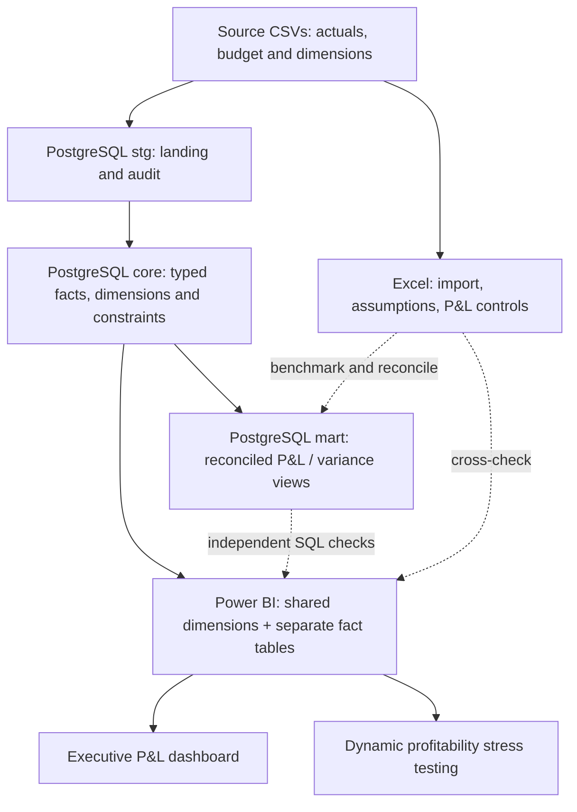

# TechVault Inc. | Corporate FP&A Analytics & Profitability Stress Testing

**An end-to-end financial analytics portfolio case study: Excel → PostgreSQL → Power BI**

> **The business problem:** Financial managers need to know whether actual performance meets plan, why profit differs from budget, where expense overruns originate, and how exposed earnings are to rising costs. This project brings those questions into one coherent reporting design rather than treating a dashboard as the entire solution.

**Tech stack:** Microsoft Excel · Power Query · PivotTables · PostgreSQL · SQL · Power BI · Power Query · DAX · Git/GitHub  
**Analysis window:** 2023–2025 · **Illustrated dashboard selection:** 2025 · **Currency:** USD  
**Project type:** Independent portfolio case study / demonstration dataset. Numbers describe the **modeled business**, not benefits or revenue earned by the project author.

[Explore Excel](excel/README.md) · [Explore SQL](sql/README.md) · [Explore Power BI](powerbi/README.md) · [Architecture](docs/architecture.md) · [Controls and caveats](docs/evidence-and-validation.md) · [Interview guide](career/INTERVIEW_PREP.md)

## Executive overview

The analysis connects financial transactions and budget records to a controlled profit-and-loss model, then surfaces actionable questions in two executive Power BI pages:

1. **Executive P&L Overview:** Actual vs. Budget trends, a P&L statement, net-income variance bridge, department expense overruns, account-level drivers and margin trends.
2. **Scenario Analysis & Stress Testing:** A user-adjustable cost-shock assumption, a profitability sensitivity curve, scenario P&L and net-income waterfall, and a department exposure matrix.

The value is **traceability**: moving from a top-line variance to a financial-statement component, time period, department or account, while retaining a separate model for testing assumptions.

## Dashboard previews

### 1. Executive P&L overview


### 2. Profitability sensitivity and stress testing


## Key insights shown in the dashboards

| Metric / finding | Selection | Result | Interpretation |
|---|---|---:|---|
| Revenue | FY2025 | **$152.8M** | Actual revenue in the model |
| Gross margin | FY2025 | **72.7%** | Gross profit as a share of revenue |
| Operating expenses | FY2025 | **$60.4M** | Actual modeled OPEX |
| Operating margin | FY2025 | **33.2%** | Operating income / revenue |
| Actual net income | FY2025 | **$51.1M** | Final net income after net other |
| Net-income budget gap | FY2025 | **−15.9%** | Actual below budget; approximately **−$9.6M** |
| +10% cost stress | FY2025 | **$40.9M** scenario net income | About **$10.2M** lower than the baseline |
| Scenario net-margin change | FY2025 | **−6.7 percentage points** | Mechanical sensitivity, **not a prediction** |

**2025 net-income variance bridge (rounded, USD millions):** Budget net income **60.8** − revenue impact **4.9** − COGS impact **3.9** − OPEX impact **1.3** + net-other impact **0.4** ≈ actual net income **51.1**. Source visuals contain rounded figures; small arithmetic differences reflect rounding.

**Longer-term operating story (guide benchmarks):** Modeled revenue increases from approximately **$44.4M (2023)** to **$106.1M (2024)** and **$152.8M (2025)**. Gross margin moves **80.6% → 75.4% → 72.7%**, while operating margin moves **19.0% → 32.0% → 33.2%**. This raises an FP&A question: *Is operating leverage compensating for growing direct-cost pressure?* It is an analytical hypothesis, not a proven causal explanation.

## The solution architecture



**Role of each layer**

| Layer | Responsibility | Why it matters |
|---|---|---|
| **Excel** | Understand transaction grain; import via Power Query; validate figures; build assumption-driven budget exercises; maintain control checks | Financial logic is visible and challengeable before visualizing it |
| **PostgreSQL** | Preserve staging; inspect data quality; enforce keys and relationships in core; aggregate actual and budget to a common grain; expose management-ready views | Reduces duplication, reconciliation failures and grain-related errors |
| **Power BI** | Star schema, DAX P&L, dynamic variances, time intelligence, waterfalls, drill-downs and controlled what-if analysis | Supports interactive business decisions without hard-coded presentation numbers |

**Important modeling rule:** The primary Power BI model uses **`core` fact/dimension tables**, not raw facts plus pre-aggregated `mart` views summed together. SQL mart outputs are independent references for QA, not extra fact tables for double counting.

## Analysis design and business questions

| Business question | Analytical capability | Management use |
|---|---|---|
| Are we above or below plan? | Revenue, COGS, OPEX and net-income actual-versus-budget comparisons | Prioritize variance review |
| Which P&L lines created the gap? | Net-income waterfall / bridge | Explain contribution rather than only report a percentage |
| Where is expense pressure concentrated? | Department variance and account ranking | Direct attention to the largest absolute dollar drivers |
| How is profitability evolving? | Monthly trends, YTD and rolling metrics, margin trends | Distinguish growth from profitability quality |
| How much profit is at risk if costs change? | Adjustable COGS/OPEX shock, scenario bridge, sensitivity grid | Discuss risk exposure under explicit assumptions |

For 2025, the visualized net-income gap is **not** simply “expenses are high”: modeled revenue is approximately **$4.9M below budget**, COGS has a roughly **$3.9M unfavorable impact**, and OPEX adds roughly **$1.3M unfavorable impact**, partially offset by **$0.4M** of other activity. The account and department views indicate *where to investigate*; the screenshots alone do not prove why an individual transaction happened.

## Financial model and calculation conventions

```text
Gross Profit       = Revenue - COGS
Operating Income  = Gross Profit - OPEX
Net Income        = Operating Income + Net Other
Gross Margin %    = Gross Profit / Revenue
Operating Margin %= Operating Income / Revenue
Net Margin %      = Net Income / Revenue
Variance $        = Actual - Budget
Variance %        = (Actual - Budget) / Budget  [when budget ≠ 0]
```

**Signs require business interpretation.** Positive actual-minus-budget is favorable for revenue or income but unfavorable for positive expense balances. In the model, other income is signed positive and other expense signed negative; net other is **added**, not subtracted twice.

The budget is at a **monthly department/account/scenario business grain** (confirm any additional natural-key fields in the exported dataset). Actuals contain **individual financial postings**. Both must be **aggregated to a common month/department/account grain before joining**. A budget scenario must be explicitly selected when several versions share a period.

## Scenario logic — what it actually proves

The adjustable shock ranges from **−10% to +25%**, in 1-percentage-point steps. It changes both COGS and OPEX proportionally, while revenue and net-other remain fixed:

```text
Scenario COGS        = Actual COGS × (1 + shock)
Scenario OPEX        = Actual OPEX × (1 + shock)
Scenario Net Income  = Revenue - Scenario COGS - Scenario OPEX + Net Other
Scenario Net Margin = Scenario Net Income / Revenue
Net Margin Impact pp = (Scenario Net Margin - Baseline Net Margin) × 100
```

**FY2025 example, +10%:** Baseline COGS **$41.8M** + OPEX **$60.4M** = **$102.2M**. Adding 10% costs **~$10.2M**, lowering modeled net income **~$51.1M → $40.9M** and net margin **~33.5% → 26.8%** (about **−6.7 pp**). The **33.2%** on the first dashboard is *operating margin*, not net margin.

This is a **mechanical stress test**. It does *not* model revenue elasticity, customer reactions, changes in tax rates, financing, balance-sheet movements, working capital, or cash flow. Department cost exposure is **not department-level net profit**.

## Data scope and controls

The supplied implementation guides specify these whole-period financial/data control targets; the screenshots independently show a subset of **2025** results:

| Whole-period target (2023–2025) | Expected value |
|---|---:|
| Actual financial postings | **22,414** |
| Budget records | **1,404** |
| Date dimension rows | **1,096** |
| Departments | **12** |
| Accounts | **38** |
| Revenue | **~$303.37M** |
| COGS | **~$76.46M** |
| Gross profit | **~$226.91M** |
| OPEX | **~$133.81M** |
| Operating income | **~$93.10M** |
| Net income | **~$94.26M** |


## Repository structure

```text
TechVault_Corporate_FPA_Portfolio/
├── README.md                         # Main project narrative
├── excel/
│   └── README.md                     # Excel / financial-controls phase
├── sql/
│   └── README.md                     # PostgreSQL architecture and marts
├── powerbi/
│   ├── README.md                     # Semantic model and dashboards
│   └── screenshots/
│       ├── 01_executive_pnl_overview.png
│       └── 02_scenario_analysis.png
|
├── .gitignore
└── .vscode/extensions.json
```

**Next assets to add from the actual working files** (not included in the supplied materials):

```text
excel/TechVault_FP&A_Excel_Model.xlsx
sql/00_create_schemas.sql
sql/01_create_core_tables.sql
sql/02_constraints_indexes.sql
sql/03_validation.sql
sql/04_financial_controls.sql
sql/05_monthly_variance_view.sql
sql/06_pnl_views.sql
sql/07_management_queries.sql
powerbi/TechVault_FP&A.pbix
powerbi/dax/01_core_financials.dax
powerbi/dax/02_budget_variance.dax
powerbi/dax/03_time_intelligence.dax
powerbi/dax/04_stress_testing.dax
```

Add real, tested files only. A beautiful README is not a substitute for a reproducible workbook, SQL implementation and `.pbix` model.

## Reproducibility and evaluation

1. Import controlled/frozen CSVs without rewriting them. Confirm keys, signs, dates and full-period totals.
2. Reconcile financial classifications and sample driver-based assumptions in Excel.
3. Load PostgreSQL `stg`, validate, promote to `core`, add constraints and create `mart` views. Verify that month/department/account totals match Excel.
4. Import `core` into Power BI in **Import mode**. Confirm one-to-many, single-direction relationships from shared dimensions to the two separate facts.
5. Compare DAX results with SQL, including 2025 P&L, department variance, net-income bridge, and shock=0 and +10% cases.
6. Inspect the dashboard under Year=2025; use screenshots to compare visual output after refresh.

**Evidence status:** This packaged repo contains documentation and the two supplied report screenshots. The source files provided for this request are **phase guides**, not executable SQL, Excel workbook or `.pbix`; thus end-to-end run success cannot be independently verified from this package alone. When you add tested source assets, update [the evidence log](docs/evidence-and-validation.md) and remove that qualification only if warranted.

## Boundaries and honest claims

- No causal attribution of expenses without transaction-level investigation.
- No cash-flow forecast, product-level gross-margin allocation, validated customer LTV or formal net revenue retention model.
- No proven company revenue lift, realized cost savings, process time saved or business adoption metrics.
- No claim of advanced scale/performance tuning from ~22K fact rows; indexes and model design reflect sound habits, not demonstrated big-data engineering.
- A simulated portfolio P&L and what-if engine demonstrate **analytical capability**, not audited financial reporting.

## Why this project deserves a look

The differentiator is not the chart count; it is the **financial reasoning and layer separation**: controlled inputs, account classifications, correct fact grain, SQL cross-checks, time-aware DAX, explainable variances, a transparent stress assumption and clear limitations. It brings financial analysis closer to a manager's next decision: **What happened? Why might it have happened? Where should we investigate? What changes under a stated assumption?**

